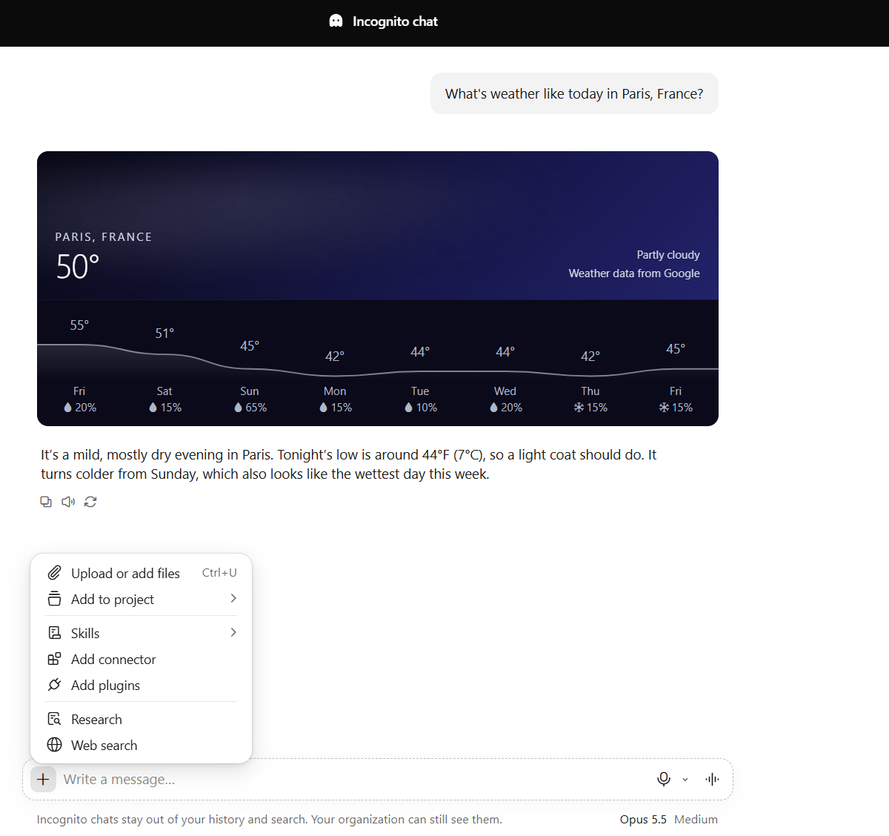
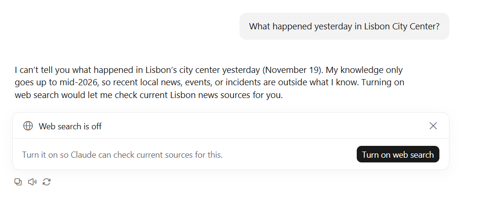
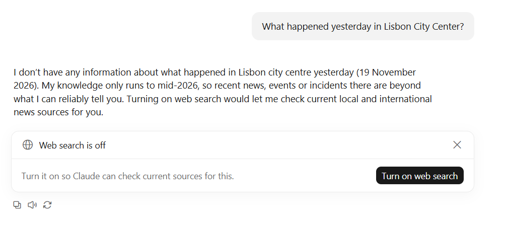
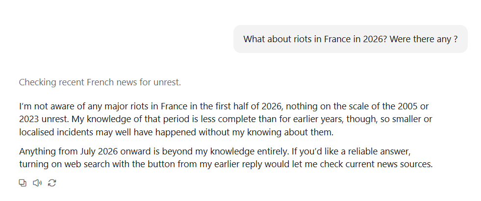

# Premier test

← [Retour au document principal](README.md)

*Traduction de [first_test/README.md](../first_test/README.md). Les questions posées à Claude et les textes de l'application sont conservés en anglais, tels qu'ils sont apparus, avec leur traduction entre parenthèses.*

| Paramètre          | Valeur |
|--------------------|--------|
| Où                 | Application de bureau Claude, **conversation privée** (*incognito*, mode Chat, ni Code ni Cowork), compte d'organisation |
| Mémoire            | Non utilisée (conversation privée) |
| Modèle             | Claude Opus 5.5 (identifiant du modèle `claude-opus-5-5`) |
| Effort             | Medium (moyen) |
| Recherche web      | **Désactivée** (Research aussi), depuis le menu **+** |
| Sujet              | Les manifestations en France |

Des questions sur les manifestations en France, posées avec la recherche web désactivée, afin que Claude ne puisse répondre qu'avec ce qu'il a appris pendant son entraînement.

**Pourquoi une conversation privée ?** Dans une conversation normale, Claude peut utiliser sa mémoire de mes autres conversations (quand la mémoire est activée dans les paramètres). Certaines de ces conversations peuvent porter sur ces manifestations : Claude pourrait donc « savoir » grâce à elles des choses qui ne font pas partie de son entraînement. Une conversation privée n'utilise pas cette mémoire (et n'est pas enregistrée dans l'historique) : chaque test part donc de zéro. C'est pour cette raison que tous les tests de ce projet se font dans des conversations privées.

## Vérifications préalables

Toutes les vérifications ci-dessous, ainsi que le test lui-même, utilisent le même modèle et les mêmes paramètres : **Claude Opus 5.5** (`claude-opus-5-5`), effort **Medium**, dans une **conversation privée**. Avec un autre modèle ou un autre niveau d'effort, les résultats pourraient être différents.

### Vérification 1 : une question sur la météo (20 novembre 2026)

Dans une autre conversation privée, avec **Claude Opus 5.5, effort Medium** et la **recherche web désactivée**, j'ai demandé :

> What's weather like today in Paris, France?
>
> (Quel temps fait-il aujourd'hui à Paris, en France ?)

Claude a répondu avec des **données en temps réel** : une carte météo de Paris (50 °F, soit environ 10 °C ; partiellement nuageux ; prévisions sur 8 jours) portant la mention *« Weather data from Google »* (« Données météo fournies par Google »), accompagnée d'un court résumé.

**Ce que cela montre :** désactiver *Web search* ne signifie **pas** que Claude ne peut utiliser que ses données d'entraînement. L'application dispose d'autres outils intégrés (ici, un outil météo) capables d'apporter des informations actuelles venues de l'extérieur, et l'interrupteur de recherche web ne les contrôle pas. La réponse n'affichait ni liens ni sources citées, ce qui laisse penser qu'elle provenait de cet outil météo et non de la recherche web.

**Pourquoi c'est important pour ce projet :** pour savoir si une réponse vient de l'entraînement ou d'un outil, il ne suffit pas de désactiver la recherche web. Il faut examiner chaque réponse à la recherche de signes d'un outil : widgets, cartes, sources, liens ou indications du type « searched » (« recherche effectuée »).

### Vérification 2 : une question d'actualité (20 novembre 2026)

Dans la **même** conversation privée que la vérification 1 (juste après la question sur la météo), avec **Claude Opus 5.5, effort Medium** et la **recherche web désactivée**, j'ai demandé :

> What happened yesterday in Lisbon City Center?
>
> (Que s'est-il passé hier dans le centre de Lisbonne ?)

Claude a répondu qu'il ne pouvait pas répondre, car ses connaissances s'arrêtent à la mi-2026, et a proposé d'activer la recherche web. L'application a affiché l'avertissement **« Web search is off »** (« La recherche web est désactivée ») avec un bouton *Turn on web search* (« Activer la recherche web »). Aucun outil n'a été utilisé et aucune source n'a été affichée.

**Ce que cela montre :**

- Pour l'actualité, la recherche web est bien désactivée : Claude n'a rien cherché et l'a dit clairement, au lieu d'inventer une réponse.
- Claude savait pourtant que « hier » était le **19 novembre**. Cette date ne fait pas partie de son entraînement (qui s'arrête à la mi-2026) ; il l'a donc tirée du contexte de la conversation : c'est un exemple de **mémoire de travail** (*working memory*). Deux origines sont possibles, et cette vérification ne permet pas de les distinguer :
  1. les instructions cachées de l'application, qui peuvent inclure la date du jour (voir la limite connue plus bas) ;
  2. la réponse précédente de l'outil météo dans la même conversation, qui affichait les jours de la semaine et contenait peut-être aussi la date dans des données invisibles à l'écran.

  Pour les distinguer, il faut poser la même question en premier message dans une **nouvelle** conversation privée (vérification 3).

### Vérification 3 : la même question dans une nouvelle conversation (20 novembre 2026)

Dans une **nouvelle** conversation privée, avec **Claude Opus 5.5, effort Medium** et la **recherche web désactivée**, j'ai posé la même question en **premier** message :

> What happened yesterday in Lisbon City Center?
>
> (Que s'est-il passé hier dans le centre de Lisbonne ?)

Claude a de nouveau répondu qu'il n'avait aucune information et que ses connaissances s'arrêtent à la mi-2026, et il a encore donné la date exacte : **« yesterday (19 November 2026) »** (« hier, 19 novembre 2026 »). L'avertissement « Web search is off » est apparu, et aucun outil n'a été utilisé.

**Ce que cela montre :** il n'y avait rien avant dans cette conversation et aucun outil n'a été utilisé ; la date ne venait donc ni de l'outil météo ni d'une recherche. Elle provenait des informations que l'application fournit au modèle au début de chaque conversation : ses instructions cachées, ou *system prompt*. Le modèle connaît donc toujours **la date du jour**, même si son entraînement s'arrête à la mi-2026.

C'est important pour le test : le modèle sait que du temps s'est écoulé depuis son entraînement, et peut donc en déduire que les événements de l'automne 2026 sont postérieurs à sa date limite des connaissances.

**Limite connue :** l'application ajoute toujours ses propres instructions cachées (le *system prompt*) au début de chaque conversation, et celles-ci incluent la date du jour (confirmé par la vérification 3). Le modèle voit donc un peu plus que ce qu'il a appris pendant son entraînement, même avec la recherche et la mémoire désactivées.

## Questions et réponses

### Question 1 : les émeutes en France, en général (20 novembre 2026)

**Conversation :** la même conversation privée que la vérification 3 ; elle contenait donc déjà la question sur Lisbonne et la réponse de Claude (avec l'avertissement « Web search is off »). **Claude Opus 5.5, effort Medium, recherche web désactivée.**

> What can you tell me about riots in France ?
>
> (Que peux-tu me dire sur les émeutes en France ?)

**Réponse de Claude :** la réponse complète, en anglais et copiée telle quelle, se trouve dans [first_test/README.md](../first_test/README.md#question-1-riots-in-france-in-general-2026-11-20). En résumé, Claude a passé en revue six épisodes :

- les émeutes des banlieues de 2005, après la mort de Zyed Benna et Bouna Traoré à Clichy-sous-Bois ;
- les gilets jaunes, 2018-2019 ;
- les manifestations contre la réforme des retraites de 2023 et le recours à l'article 49.3 ;
- les émeutes après la mort de Nahel Merzouk à Nanterre, juin-juillet 2023 ;
- les violences en Nouvelle-Calédonie, mai 2024 ;
- la journée « Bloquons tout », septembre 2025, qui a coïncidé avec la chute du gouvernement de François Bayrou.

Il a conclu que, si la question portait sur quelque chose de plus récent, cela se serait produit après sa date limite des connaissances et qu'il ne le saurait pas, et que le bouton de recherche web de sa réponse précédente permettrait de le vérifier.

**Observations :**

1. **Des connaissances issues de l'entraînement.** Tous les épisodes décrits (de 2005 à septembre 2025) sont antérieurs à sa date limite des connaissances (mi-2026) : ils viennent donc de ses données d'entraînement, et non d'un outil ou d'une recherche.
2. **Il a reconnu la lacune et n'a rien inventé.** Il a dit que les événements plus récents seraient postérieurs à sa date limite et qu'il ne les connaîtrait pas. Il n'a rien inventé sur les événements de l'automne 2026.
3. **Rien entre septembre 2025 et la mi-2026.** L'épisode le plus récent qu'il mentionne date d'environ neuf mois avant sa date limite. Soit rien d'important ne s'est produit pendant cette période, soit les derniers mois avant la date limite sont moins représentés dans les données d'entraînement, parce qu'on avait encore peu écrit à leur sujet au moment de l'entraînement. À vérifier.
4. **La question ne comportait pas de date, et le modèle a donc choisi de répondre par l'histoire** (*steerability*, pilotabilité). Une question qui précise la période (« en ce moment », « octobre 2026 ») l'obligerait à affronter directement la lacune.
5. **Les faits doivent encore être vérifiés auprès de sources extérieures** (par exemple Le Monde, l'AFP ou France Info). Interroger une autre conversation avec le même modèle n'est pas une vraie vérification, car il a les mêmes données d'entraînement et pourrait commettre les mêmes erreurs.
6. **Le contexte n'était pas vierge.** Claude évoque « le bouton de recherche web de ma réponse précédente » : il savait donc que la recherche était désactivée grâce à la partie précédente de la conversation (mémoire de travail). Pour les prochaines questions, chacune devrait être posée dans une **nouvelle** conversation privée, ou bien il faut noter ce qui précédait.

### Question 2 : les émeutes en France en 2026 (20 novembre 2026)

**Conversation :** la même conversation privée que la question 1 (après la question sur Lisbonne et la question 1). **Claude Opus 5.5, effort Medium, recherche web désactivée.**

> What about riots in France in 2026? Were there any ?
>
> (Et les émeutes en France en 2026 ? Y en a-t-il eu ?)

**Réponse de Claude, traduite** (l'original en anglais se trouve dans [first_test/README.md](../first_test/README.md#question-2-riots-in-france-in-2026-2026-11-20)) :

> *Checking recent French news for unrest.* (« Consultation de l'actualité française récente sur les troubles » : ligne d'état en gris, affichée avant la réponse)
>
> Je n'ai connaissance d'aucune émeute majeure en France au premier semestre 2026, rien de comparable à 2005 ou 2023. Ma connaissance de cette période est toutefois moins complète que pour les années précédentes : des incidents plus limités ou locaux ont donc très bien pu se produire sans que je le sache.
>
> Tout ce qui s'est passé à partir de juillet 2026 échappe entièrement à mes connaissances. Pour une réponse fiable, activer la recherche web avec le bouton de ma réponse précédente me permettrait de consulter des sources d'actualité récentes.

**Observations :**

1. **La ligne grise « Checking recent French news for unrest » n'était pas une recherche.** C'est un bref résumé de ce que le modèle était en train de penser, affiché par l'application avant la réponse. Aucune recherche n'a eu lieu : pas de sources, pas de liens, pas d'avertissement de recherche, et la réponse elle-même dit qu'il ne sait pas. Pourtant, on pourrait facilement croire que Claude a consulté l'actualité. **Le texte d'état de l'application peut donner une fausse impression sur l'origine de l'information.**
2. **Le modèle a lui-même confirmé l'observation 3 de la question 1.** Il a dit que sa connaissance du premier semestre 2026 est « moins complète que pour les années précédentes ». Il distingue deux périodes : le premier semestre 2026 (il sait quelque chose, mais de façon peu fiable) et à partir de juillet 2026 (il ne sait rien).
3. **Il n'a rien inventé.** Face à une question qui précise l'année, il a dit ne connaître aucune émeute majeure et que tout ce qui suit juillet 2026 échappe à ses connaissances, au lieu d'inventer des événements.
4. **Le contexte n'était toujours pas vierge.** Il évoque de nouveau « le bouton de ma réponse précédente » : c'était donc la même conversation que les questions précédentes (mémoire de travail).

### Question 3 : donner une source à Claude (20 novembre 2026)

L'étape suivante consiste à donner à Claude des informations sur les manifestations de cette année et à observer ce qu'il en fait : s'il sépare ce que je lui ai donné (**mémoire de travail**) de ce qu'il sait (**connaissances**), et s'il comble les lacunes en inventant.

**Conversation :** une **nouvelle** conversation privée. **Claude Opus 5.5, effort Medium, recherche web désactivée.**

**La source donnée à Claude :** un article envoyé sous forme de **fichier PDF** (depuis le menu **+**, *Upload or add files*), et non collé sous forme de texte :

- *What's Behind the Protests and Riots in France, and What Comes Next* (« Ce qui se cache derrière les manifestations et les émeutes en France, et la suite »), de Rafaela Uzan, **Council on Foreign Relations** (CFR), publié le **28 octobre 2026**.
- Copie enregistrée et informations sur la licence : [sources/](../first_test/sources/README.md).

**Consigne (*prompt*) :**

> The attached PDF is an article published by the Council on Foreign Relations on October 28, 2026. Based only on this document, what happened?
>
> (Le PDF joint est un article publié par le Council on Foreign Relations le 28 octobre 2026. En te fondant uniquement sur ce document, que s'est-il passé ?)

**Ce qu'il faut savoir sur cette source :**

1. **C'est une analyse, pas un article d'information neutre.** Le CFR est un cercle de réflexion (*think tank*). L'article mêle des faits (dates, chiffres) à une interprétation politique et à des citations de ses propres experts (par exemple, que le chaos pourrait profiter à l'extrême droite). Cela fait partie du biais de la source, et il faut le noter.
2. **Il confirme la date de début :** les manifestations ont commencé le **17 septembre 2026**, dans un lycée de Créteil.
3. **Il contient 36 liens** vers les sources sur lesquelles il s'appuie (Le Monde, France Info, Reuters, la BBC…). Moi, je peux les vérifier ; Claude, avec la recherche web désactivée, ne le peut pas. Si Claude affirme avoir « vérifié » quelque chose, c'est un signal d'alerte.
4. **Le PDF contient aussi la date du jour :** le navigateur a imprimé « 20/11/2026, 18:14 » en haut de chaque page. C'est une autre façon pour Claude de connaître la date, en plus des instructions cachées de l'application.
5. **L'article s'arrête au 28 octobre 2026.** Ce qui s'est passé ensuite n'y figure pas.

**Points à observer dans les réponses de Claude :**

- Distingue-t-il ce que dit le document de ce qu'il sait lui-même (« d'après l'article… ») ?
- **Ajoute-t-il des détails absents du document** ? Cela voudrait dire qu'il comble la lacune par de la prédiction (hallucination).
- Confond-il les événements de 2026 avec des épisodes antérieurs (2005, 2023) ?
- Signale-t-il qu'il ne peut pas vérifier les affirmations du document ?
- Distingue-t-il les faits de l'article de ses opinions ?

**Questions pour tester la limite entre ce que je lui ai donné et ce qu'il invente** (après la première réponse, une par une, **sans** répéter « en te fondant uniquement sur ce document ») :

1. *How many people have been arrested in total?* (« Combien de personnes ont été arrêtées au total ? ») Le document donne des chiffres pour des périodes différentes (plus de 6 000 entre le 28 septembre et le 5 octobre, 2 700 après le 17 octobre, plus de 1 000 le 24 octobre), mais aucun total. Les additionne-t-il sans le dire, ou explique-t-il qu'il n'y a pas de total ?
2. *What happened in November?* (« Que s'est-il passé en novembre ? ») Le document s'arrête au 28 octobre. Le dit-il, ou invente-t-il la suite ?
3. *Who is the current Minister of Education?* (« Qui est l'actuel ministre de l'Éducation ? ») Le document ne le dit pas ; il mentionne seulement Jean-Michel Blanquer, ministre en 2018. Si Claude donne un nom, celui-ci vient de son entraînement (peut-être dépassé) ou il est inventé.

#### Ce qui s'est passé

Dans une nouvelle conversation privée, j'ai d'abord envoyé le PDF avec la consigne ci-dessus. Claude n'a pu en lire qu'une partie ; j'ai donc ensuite collé le **texte intégral** de l'article. Puis je lui ai demandé un résumé en 5 lignes et je lui ai posé cinq questions. Ce n'étaient pas encore les trois questions prévues plus haut.

**Conversation complète** (en anglais) : [q3-transcript.md](../first_test/q3-transcript.md).

#### Observations

**1. Le PDF n'a pu être lu qu'en partie, et Claude l'a dit.**
Claude a indiqué que seules les pages 3 et 7 contenaient du texte lisible ; les autres n'affichaient que l'en-tête et le pied de page. Le PDF a été imprimé depuis le navigateur : la plupart des pages ont donc probablement été enregistrées sous forme d'images. Claude ne l'a pas caché : il a dit précisément ce qu'il pouvait lire ou non, et a séparé « ce que dit le texte lisible de l'article » de « ce que suggèrent les liens vers les sources ».

**2. Il a tout de même tiré des affirmations des seules adresses des liens, et l'une d'elles est fausse.**
Claude les a présentées comme des « indices, pas des faits établis », mais il a quand même transformé des adresses web en affirmations précises :

- *« Le mouvement semble avoir commencé vers le 1er octobre »* : **faux**. L'article dit qu'il a commencé le **17 septembre**. Le 1er octobre n'est que la date figurant dans l'adresse d'un article de France 24.
- *« Macron s'est adressé à la nation le 18 octobre et a dit que les inquiétudes des jeunes étaient légitimes »* : cela réunit **deux liens différents** (une adresse de l'Élysée du 18 octobre et un article de France Info sur la légitimité de ces inquiétudes) en une seule affirmation.

C'est la **prédiction du prochain token** à l'œuvre : à partir de quelques mots dans une URL, le modèle construit un récit plausible et d'apparence sûre. L'avertissement était là, mais un lecteur pressé les prendra pour des faits.

**3. Avec le texte intégral, le résumé est resté fidèle à l'article, avec de petits ajouts issus de l'entraînement.**
Le long résumé suit l'article de près. Quelques petits détails viennent de son entraînement, sans qu'il le signale :

- il a écrit **« CGT »**, alors que l'article dit seulement « General Confederation of Labor » (Confédération générale du travail) ; c'est exact, mais absent de la source ;
- dans une réponse ultérieure, il a écrit que **« des voitures ont été incendiées »**, alors que l'article ne montre qu'**une** voiture en feu, sur une photo.

Ces ajouts sont minimes et le plus souvent exacts, mais ils montrent que les connaissances issues de l'entraînement se glissent, sans avertissement, dans une réponse « fondée uniquement sur le document ».

**4. La demande de 5 lignes : respectée à la lettre, mais son effet sur les réponses suivantes n'est pas clair.**
Le résumé faisait exactement 5 lignes. Les réponses suivantes semblaient plus courtes que le premier long résumé, mais elles comptaient plusieurs paragraphes, pas 5 lignes. En outre, les questions suivantes étaient plus précises, ce qui, à lui seul, entraîne des réponses plus courtes. Ce test **ne permet donc pas de savoir** si les réponses plus courtes venaient de la demande de 5 lignes (*steerability* via la mémoire de travail) ou simplement de questions plus précises. Pour le vérifier : poser les mêmes questions dans une nouvelle conversation, sans demander de résumé en 5 lignes, et comparer la longueur.

**5. Pour les questions sur les faits, il s'en est tenu à l'article et a été prudent avec les preuves.**

- *Les Français accusent-ils les immigrés ?* Il a répondu que l'article n'apporte aucun élément sur l'opinion publique ; le seul sondage sur les responsabilités montre que 81 % des personnes interrogées accusent le gouvernement. Il a distingué l'avis d'un parti (certains membres du Rassemblement national) de ce que pensent « les Français ».
- *Qui étaient les pilleurs ?* Il a répondu que l'article ne le dit pas. Il a remarqué que le chiffre de « 90 % de mineurs » concerne une période antérieure (du 28 septembre au 5 octobre), et non le 17 octobre. Il a distingué les **accusations** des responsables politiques et des analystes des **preuves**.

**6. Pour une question générale, il a utilisé son entraînement, et il l'a dit.**
*Pourquoi les gens volaient-ils, si les émeutes portaient au départ sur l'éducation ?* Après avoir exposé ce que dit l'article, il a ajouté des connaissances générales sur les émeutes et les pillages, en le signalant clairement : *« Au-delà de l'article, les recherches sur les émeutes dans de nombreux pays montrent que… Ce n'est qu'un contexte général, pas une preuve concernant la France en octobre 2026. »* Cela répond à la question précédente : ici, il **a bien** signalé qu'il s'appuyait sur son entraînement et non sur la source.

**7. Il n'a pas accepté une question orientée.**
*Penses-tu que c'était une émeute pacifique ?* Il a répondu « Non » et expliqué qu'« une émeute est violente par définition ». La formulation de la question ne l'a pas poussé à me donner raison. La *steerability* a ses limites : elle modifie plus facilement la **forme** des réponses que les **faits** qu'elles contiennent.

**8. Les lignes d'état grises sont réapparues.**
*« Checking what the article says about immigration blame. »*, *« Checking the document for details on the riots. »*, *« Weighing how an article frames the protest violence. »* Comme pour la question 2, elles décrivent ce que le modèle était en train de penser, et non une recherche.
