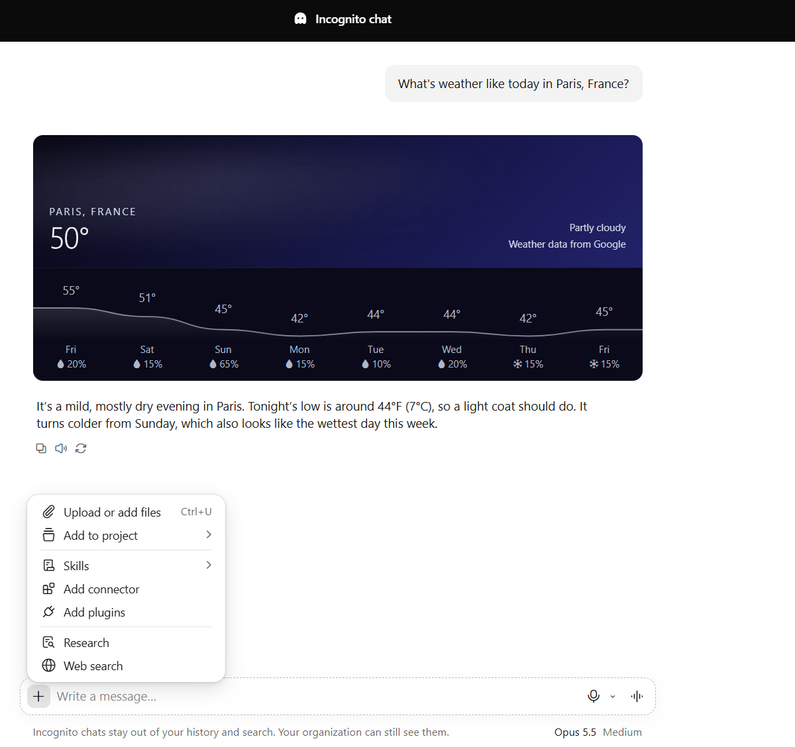
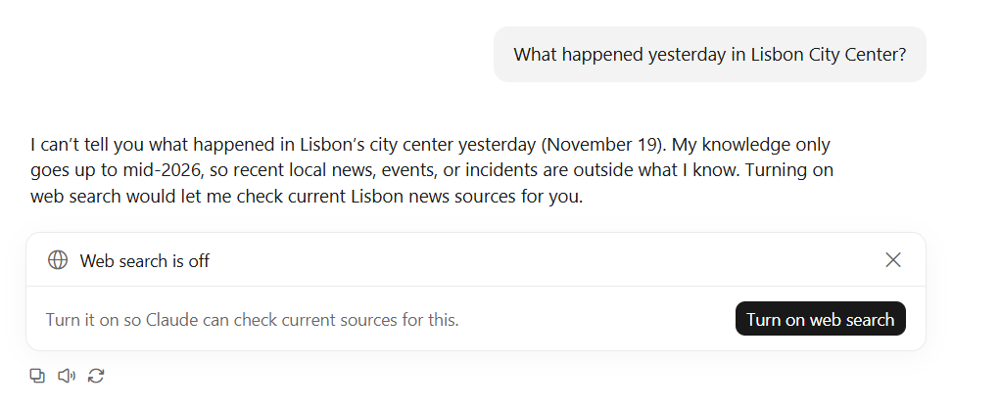
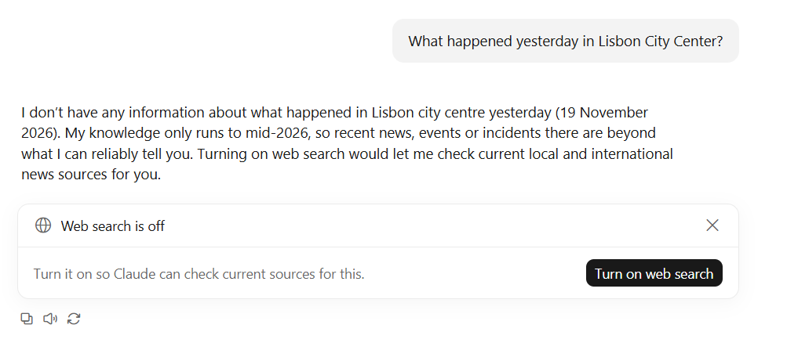
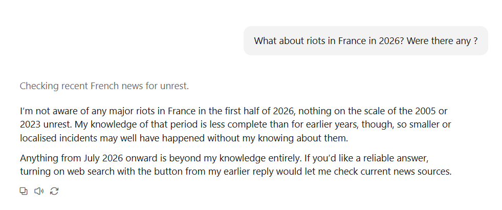

# Primera prueba

← [Volver al documento principal](README.md)

*Traducción de [first_test/README.md](../first_test/README.md). Las preguntas a Claude y los textos de la aplicación se mantienen en inglés, tal como aparecieron, con su traducción entre paréntesis.*

| Configuración    | Valor |
|------------------|-------|
| Dónde            | Aplicación de escritorio de Claude, **chat de incógnito** (modo Chat, no Code ni Cowork), cuenta de organización |
| Memoria          | No se usa (chat de incógnito) |
| Modelo           | Claude Opus 5.5 (id del modelo `claude-opus-5-5`) |
| Esfuerzo         | Medium (medio) |
| Búsqueda web     | **Desactivada** (y Research también), desde el menú **+** |
| Tema             | Las manifestaciones en Francia |

Preguntas sobre las manifestaciones en Francia, hechas con la búsqueda web desactivada, para que Claude solo pueda responder con lo que aprendió durante el entrenamiento.

## Comprobaciones previas

Todas las comprobaciones siguientes, y la propia prueba, usan el mismo modelo y la misma configuración: **Claude Opus 5.5** (`claude-opus-5-5`), esfuerzo **Medium**, en un **chat de incógnito**. Con otro modelo u otro nivel de esfuerzo, los resultados podrían ser distintos.

### Comprobación 1: una pregunta sobre el tiempo (20 de noviembre de 2026)

En un chat de incógnito aparte, con **Claude Opus 5.5, esfuerzo Medium** y la **búsqueda web desactivada**, pregunté:

> What's weather like today in Paris, France?
>
> (¿Qué tiempo hace hoy en París, Francia?)

Claude respondió con **datos en tiempo real**: una tarjeta del tiempo de París (50 °F, es decir, unos 10 °C; parcialmente nublado; previsión para 8 días) con la indicación *«Weather data from Google»* («Datos meteorológicos de Google»), además de un breve resumen.

**Qué demuestra:** desactivar *Web search* **no** significa que Claude solo pueda usar sus datos de entrenamiento. La aplicación tiene otras herramientas integradas (en este caso, una del tiempo) que pueden traer información actual del exterior, y el interruptor de búsqueda web no las controla. La respuesta no mostraba enlaces ni fuentes citadas, lo que indica que procedía de esa herramienta del tiempo y no de la búsqueda web.

**Por qué importa para este proyecto:** para saber si una respuesta viene del entrenamiento o de una herramienta, no basta con desactivar la búsqueda web. Hay que revisar cada respuesta en busca de señales de una herramienta: widgets, tarjetas, fuentes, enlaces o indicadores del tipo «searched» («buscado»).

### Comprobación 2: una pregunta sobre noticias (20 de noviembre de 2026)

En el **mismo** chat de incógnito que la comprobación 1 (justo después de la pregunta sobre el tiempo), con **Claude Opus 5.5, esfuerzo Medium** y la **búsqueda web desactivada**, pregunté:

> What happened yesterday in Lisbon City Center?
>
> (¿Qué pasó ayer en el centro de Lisboa?)

Claude respondió que no podía contestar, porque sus conocimientos solo llegan hasta mediados de 2026, y sugirió activar la búsqueda web. La aplicación mostró el aviso **«Web search is off»** («La búsqueda web está desactivada») con un botón *Turn on web search* («Activar la búsqueda web»). No se usó ninguna herramienta ni se mostraron fuentes.

**Qué demuestra:**

- Para las noticias, la búsqueda web está realmente desactivada: Claude no buscó nada y lo dijo con claridad, en lugar de inventarse una respuesta.
- Aun así, Claude sabía que «ayer» era el **19 de noviembre**. Esa fecha no forma parte de su entrenamiento (que termina a mediados de 2026), así que la sacó del contexto de la conversación: es un ejemplo de **memoria de trabajo** (*working memory*). Hay dos orígenes posibles, y esta comprobación no permite distinguirlos:
  1. las instrucciones ocultas de la aplicación, que pueden incluir la fecha de hoy (véase la limitación conocida más abajo);
  2. la respuesta anterior de la herramienta del tiempo en el mismo chat, que mostraba los días de la semana y quizá también contenía la fecha en datos que no se ven en pantalla.

  Para distinguirlos, hay que hacer la misma pregunta como primer mensaje en un chat de incógnito **nuevo** (comprobación 3).

### Comprobación 3: la misma pregunta en un chat nuevo (20 de noviembre de 2026)

En un chat de incógnito **nuevo**, con **Claude Opus 5.5, esfuerzo Medium** y la **búsqueda web desactivada**, hice la misma pregunta como **primer** mensaje:

> What happened yesterday in Lisbon City Center?
>
> (¿Qué pasó ayer en el centro de Lisboa?)

Claude volvió a decir que no tenía información y que sus conocimientos solo llegan hasta mediados de 2026, y de nuevo dio la fecha exacta: **«yesterday (19 November 2026)»** («ayer, 19 de noviembre de 2026»). Apareció el aviso «Web search is off» y no se usó ninguna herramienta.

**Qué demuestra:** en este chat no había nada antes y no se usó ninguna herramienta, así que la fecha no vino de la herramienta del tiempo ni de una búsqueda. Vino de la información que la aplicación le da al modelo al principio de cada chat: sus instrucciones ocultas, o *system prompt*. Por tanto, el modelo siempre sabe **la fecha de hoy**, aunque su entrenamiento termine a mediados de 2026.

Esto es importante para la prueba: el modelo sabe que ha pasado tiempo desde su entrenamiento y, por eso, puede deducir que los acontecimientos del otoño de 2026 son posteriores a su fecha de corte.

**Limitación conocida:** la aplicación siempre añade sus propias instrucciones ocultas (el *system prompt*) al principio de cada chat, y estas incluyen la fecha de hoy (confirmado en la comprobación 3). Así que el modelo ve algo más que lo que aprendió en el entrenamiento, aunque la búsqueda y la memoria estén desactivadas.

## Preguntas y respuestas

### Pregunta 1: los disturbios en Francia, en general (20 de noviembre de 2026)

**Chat:** el mismo chat de incógnito que la comprobación 3, así que la conversación ya contenía la pregunta sobre Lisboa y la respuesta de Claude (con el aviso «Web search is off»). **Claude Opus 5.5, esfuerzo Medium, búsqueda web desactivada.**

> What can you tell me about riots in France ?
>
> (¿Qué me puedes contar sobre los disturbios en Francia?)

**Respuesta de Claude:** la respuesta completa, en inglés y copiada tal cual, está en [first_test/README.md](../first_test/README.md#question-1-riots-in-france-in-general-2026-11-20). En resumen, Claude repasó seis episodios:

- los disturbios de las *banlieues* de 2005, tras la muerte de Zyed Benna y Bouna Traoré en Clichy-sous-Bois;
- los *gilets jaunes* (chalecos amarillos), 2018-2019;
- las protestas contra la reforma de las pensiones de 2023 y el uso del artículo 49.3;
- los disturbios tras la muerte de Nahel Merzouk en Nanterre, junio-julio de 2023;
- los disturbios en Nueva Caledonia, mayo de 2024;
- la jornada «Bloquons tout» («Bloqueemos todo»), septiembre de 2025, coincidiendo con la caída del Gobierno de François Bayrou.

Terminó diciendo que, si la pregunta era sobre algo más reciente, habría ocurrido después de su fecha de corte y no lo sabría, y que el botón de búsqueda web de su respuesta anterior permitiría buscarlo.

**Observaciones:**

1. **Conocimiento procedente del entrenamiento.** Todos los episodios que describió (de 2005 a septiembre de 2025) son anteriores a su fecha de corte (mediados de 2026), así que vienen de sus datos de entrenamiento, no de una herramienta ni de una búsqueda.
2. **Reconoció el hueco y no se inventó nada.** Dijo que lo más reciente quedaría después de su fecha de corte y que no lo sabría. No se inventó nada sobre los acontecimientos del otoño de 2026.
3. **Nada entre septiembre de 2025 y mediados de 2026.** El episodio más reciente que menciona es de unos nueve meses antes de su fecha de corte. O no ocurrió nada importante en ese periodo, o los últimos meses antes del corte están menos representados en los datos de entrenamiento, porque cuando se entrenó el modelo todavía se había escrito poco sobre ellos. Merece la pena comprobarlo.
4. **La pregunta no tenía fecha, así que el modelo eligió responder con historia** (*steerability*). Una pregunta que indique el periodo («ahora mismo», «octubre de 2026») le obligaría a enfrentarse directamente al hueco.
5. **Los hechos aún hay que contrastarlos con fuentes externas** (por ejemplo, Le Monde, AFP o France Info). Preguntar en otro chat con el mismo modelo no es una verificación real, porque tiene los mismos datos de entrenamiento y podría cometer los mismos errores.
6. **El contexto no estaba limpio.** Claude menciona «el botón de búsqueda web de mi respuesta anterior», así que sabía que la búsqueda estaba desactivada por la parte anterior del chat (memoria de trabajo). Las próximas preguntas deberían hacerse cada una en un chat de incógnito **nuevo**, o bien registrar lo que había antes.

### Pregunta 2: los disturbios en Francia en 2026 (20 de noviembre de 2026)

**Chat:** el mismo chat de incógnito que la pregunta 1 (después de la pregunta sobre Lisboa y de la pregunta 1). **Claude Opus 5.5, esfuerzo Medium, búsqueda web desactivada.**

> What about riots in France in 2026? Were there any ?
>
> (¿Y los disturbios en Francia en 2026? ¿Hubo alguno?)

**Respuesta de Claude, traducida** (el original en inglés está en [first_test/README.md](../first_test/README.md#question-2-riots-in-france-in-2026-2026-11-20)):

> *Checking recent French news for unrest.* («Consultando noticias recientes de Francia sobre disturbios»: línea de estado en gris, antes de la respuesta)
>
> No tengo constancia de disturbios importantes en Francia en el primer semestre de 2026, nada comparable a los de 2005 o 2023. Aun así, mi conocimiento de ese periodo es menos completo que el de años anteriores, así que podría haber habido incidentes más pequeños o locales sin que yo lo sepa.
>
> Todo lo ocurrido desde julio de 2026 queda completamente fuera de mi conocimiento. Si quieres una respuesta fiable, activar la búsqueda web con el botón de mi respuesta anterior me permitiría consultar fuentes de noticias actuales.

**Observaciones:**

1. **La línea gris «Checking recent French news for unrest» no era una búsqueda.** Es un breve resumen de lo que el modelo estaba pensando, que la aplicación muestra antes de la respuesta. No hubo ninguna búsqueda: no aparecieron fuentes, ni enlaces, ni aviso de búsqueda, y la propia respuesta dice que no lo sabe. Pero cualquiera podría creer que Claude había consultado las noticias. **El texto de estado de la aplicación puede dar una impresión falsa sobre el origen de la información.**
2. **El propio modelo confirmó la observación 3 de la pregunta 1.** Dijo que su conocimiento del primer semestre de 2026 es «menos completo que el de años anteriores». Distingue dos periodos: el primer semestre de 2026 (sabe algo, pero no de forma fiable) y desde julio de 2026 (no sabe nada).
3. **No se inventó nada.** Ante una pregunta que indica el año, dijo que no conocía disturbios importantes y que todo lo posterior a julio de 2026 queda fuera de su conocimiento, en lugar de inventarse acontecimientos.
4. **El contexto seguía sin estar limpio.** Vuelve a mencionar «el botón de mi respuesta anterior», así que era el mismo chat que las preguntas anteriores (memoria de trabajo).

### Pregunta 3: darle una fuente a Claude (20 de noviembre de 2026)

El siguiente paso es darle a Claude información sobre las manifestaciones de este año y ver qué hace con ella: si mantiene separado lo que le he dado (**memoria de trabajo**) de lo que sabe (**conocimiento**), y si rellena los huecos inventándose cosas.

**Chat:** un chat de incógnito **nuevo**. **Claude Opus 5.5, esfuerzo Medium, búsqueda web desactivada.**

**La fuente que le di a Claude:** un artículo subido como **archivo PDF** (desde el menú **+**, *Upload or add files*), no pegado como texto:

- *What's Behind the Protests and Riots in France, and What Comes Next* («Qué hay detrás de las protestas y los disturbios en Francia, y qué viene ahora»), de Rafaela Uzan, **Council on Foreign Relations** (CFR), publicado el **28 de octubre de 2026**.
- Copia guardada y datos de la licencia: [sources/](../first_test/sources/README.md).

**Instrucción (*prompt*):**

> The attached PDF is an article published by the Council on Foreign Relations on October 28, 2026. Based only on this document, what happened?
>
> (El PDF adjunto es un artículo publicado por el Council on Foreign Relations el 28 de octubre de 2026. Basándote solo en este documento, ¿qué pasó?)

**Lo que hay que saber de esta fuente:**

1. **Es un análisis, no una noticia neutral.** El CFR es un centro de estudios (*think tank*). El artículo mezcla hechos (fechas, cifras) con interpretación política y citas de sus propios expertos (por ejemplo, que el caos podría favorecer a la extrema derecha). Eso forma parte del sesgo de la fuente y conviene anotarlo.
2. **Confirma la fecha de inicio:** las protestas empezaron el **17 de septiembre de 2026**, en un instituto de Créteil.
3. **Incluye 36 enlaces** a las fuentes en las que se basa (Le Monde, France Info, Reuters, BBC…). Yo puedo comprobarlos; Claude, con la búsqueda web desactivada, no. Si en algún momento Claude dice que ha «comprobado» algo, es una señal de alarma.
4. **El PDF también contiene la fecha de hoy:** el navegador imprimió «20/11/2026, 18:14» en la cabecera de cada página. Es otra vía por la que Claude puede saber la fecha, además de las instrucciones ocultas de la aplicación.
5. **El artículo termina el 28 de octubre de 2026.** Lo que haya pasado después no aparece.

**Qué hay que observar en las respuestas de Claude:**

- ¿Distingue entre lo que dice el documento y lo que sabe él («según el artículo…»)?
- ¿**Añade detalles que no están en el documento**? Eso significaría que rellena el hueco con predicción (alucinación).
- ¿Confunde los acontecimientos de 2026 con otros anteriores (2005, 2023)?
- ¿Advierte de que no puede comprobar lo que afirma el documento?
- ¿Distingue los hechos del artículo de sus opiniones?

**Preguntas para poner a prueba el límite entre lo que le di y lo que se inventa** (después de la primera respuesta, una a una y **sin** repetir «basándote solo en este documento»):

1. *How many people have been arrested in total?* («¿Cuántas personas han sido detenidas en total?») El documento da cifras de periodos distintos (más de 6.000 entre el 28 de septiembre y el 5 de octubre, 2.700 tras el 17 de octubre y más de 1.000 el 24 de octubre), pero no un total. ¿Las suma sin avisar o explica que no hay un total?
2. *What happened in November?* («¿Qué pasó en noviembre?») El documento termina el 28 de octubre. ¿Lo dice o se inventa lo que pasó después?
3. *Who is the current Minister of Education?* («¿Quién es el actual ministro o ministra de Educación?») El documento no lo dice; solo menciona a Jean-Michel Blanquer, ministro en 2018. Si Claude da un nombre, viene de su entrenamiento (quizá desactualizado) o se lo inventa.

#### Qué pasó

En un chat de incógnito nuevo, primero envié el PDF con la instrucción de arriba. Claude solo pudo leer una parte, así que después pegué el **texto completo** del artículo. Luego le pedí un resumen en 5 líneas y le hice cinco preguntas. Todavía no eran las tres preguntas previstas más arriba.

**Conversación completa** (en inglés): [q3-transcript.md](../first_test/q3-transcript.md).

#### Observaciones

**1. El PDF solo se pudo leer en parte, y Claude lo dijo.**
Claude dijo que solo las páginas 3 y 7 tenían texto legible; las demás solo mostraban la cabecera y el pie de página. El PDF se imprimió desde el navegador, así que probablemente la mayoría de las páginas se guardaron como imágenes. Claude no lo ocultó: dijo exactamente qué podía leer y qué no, y separó «lo que dice el texto legible del artículo» de «lo que sugieren los enlaces a las fuentes».

**2. Aun así, sacó afirmaciones solo de las direcciones de los enlaces, y una es falsa.**
Claude las presentó como «pistas, no hechos establecidos», pero convirtió direcciones web en afirmaciones concretas:

- *«El movimiento parece haber empezado hacia el 1 de octubre»*: **falso**. El artículo dice que empezó el **17 de septiembre**. El 1 de octubre es solo la fecha que aparece en la dirección de un artículo de France 24.
- *«Macron se dirigió a la nación el 18 de octubre y dijo que las preocupaciones de los jóvenes eran legítimas»*: une **dos enlaces distintos** (un discurso del Elíseo del 18 de octubre y un artículo de France Info sobre la legitimidad de esas preocupaciones) en una sola afirmación.

Esto es la **predicción del siguiente token** en acción: a partir de unas pocas palabras de una URL, el modelo construye una historia verosímil y con apariencia de seguridad. La advertencia estaba ahí, pero quien lea por encima lo tomará por hechos.

**3. Con el texto completo, el resumen se ciñó al artículo, con pequeños añadidos del entrenamiento.**
El resumen largo sigue de cerca el artículo. Algunos detalles pequeños salieron de su entrenamiento, sin avisar:

- escribió **«CGT»**, mientras que el artículo solo dice «General Confederation of Labor» (Confederación General del Trabajo); es correcto, pero no está en la fuente;
- en una respuesta posterior escribió que **«se quemaron coches»**, cuando el artículo solo muestra **un** coche en llamas, en una foto.

Son añadidos pequeños y casi siempre correctos, pero muestran que el conocimiento del entrenamiento se mezcla, sin aviso, en una respuesta «basada solo en el documento».

**4. La petición de 5 líneas: la cumplió exactamente, pero su efecto en las respuestas siguientes no está claro.**
El resumen ocupó exactamente 5 líneas. Las respuestas siguientes parecían más cortas que el primer resumen largo, pero tenían varios párrafos, no 5 líneas. Además, las preguntas posteriores eran más concretas, y eso por sí solo produce respuestas más cortas. Así que esta prueba **no permite saber** si las respuestas más cortas se debieron a la petición de 5 líneas (*steerability* a través de la memoria de trabajo) o simplemente a que las preguntas eran más concretas. Para comprobarlo: hacer las mismas preguntas en un chat nuevo, sin pedir el resumen en 5 líneas, y comparar la extensión.

**5. En las preguntas sobre los hechos, se ciñó al artículo y fue cuidadoso con las pruebas.**

- *¿Los franceses culpan a los inmigrantes?* Dijo que el artículo no aporta datos sobre la opinión pública; la única encuesta sobre responsabilidades muestra que el 81 % culpa al Gobierno. Separó la opinión de un partido (algunos miembros del Reagrupamiento Nacional) de lo que piensan «los franceses».
- *¿Quiénes eran los saqueadores?* Dijo que el artículo no lo dice. Se dio cuenta de que la cifra del «90 % de menores» corresponde a un periodo anterior (del 28 de septiembre al 5 de octubre), no al 17 de octubre. Separó las **acusaciones** de políticos y analistas de las **pruebas**.

**6. En una pregunta general, usó su entrenamiento y lo dijo.**
*¿Por qué robaba la gente, si los disturbios empezaron por la educación?* Después de explicar lo que dice el artículo, añadió conocimientos generales sobre disturbios y saqueos, y lo indicó con claridad: *«Más allá del artículo, las investigaciones sobre disturbios en muchos países muestran que… Esto es solo contexto general, no una prueba sobre Francia en octubre de 2026»*. Esto responde a la duda anterior: aquí **sí** avisó de que usaba su entrenamiento y no la fuente.

**7. No aceptó una pregunta tendenciosa.**
*¿Crees que fue un disturbio pacífico?* Respondió «No» y explicó que «un disturbio es violento por definición». La forma de la pregunta no lo empujó a darme la razón. La *steerability* tiene límites: cambia con más facilidad la **forma** de las respuestas que los **hechos** que contienen.

**8. Volvieron a aparecer las líneas de estado en gris.**
*«Checking what the article says about immigration blame.»*, *«Checking the document for details on the riots.»*, *«Weighing how an article frames the protest violence.»* Como en la pregunta 2, describen lo que el modelo estaba pensando, no una búsqueda.
