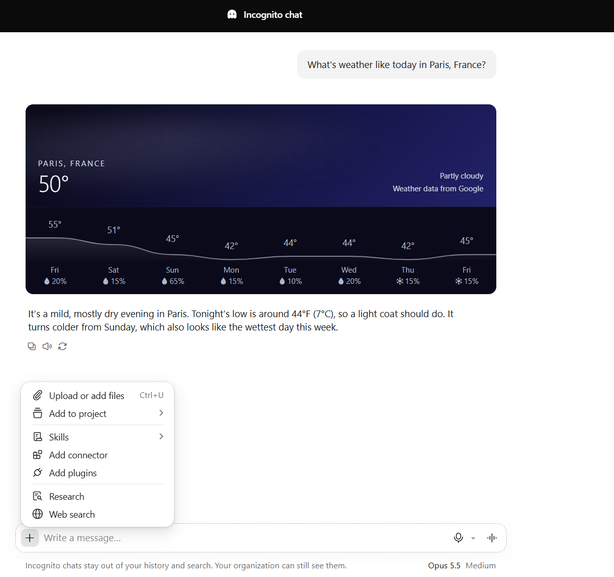
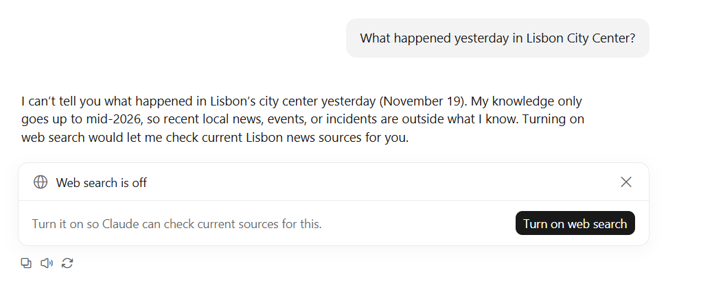
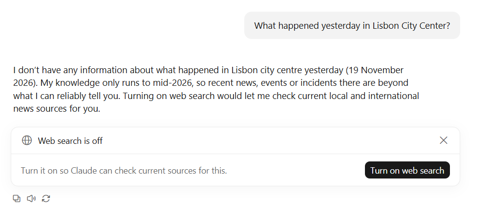

# First test

| Setting    | Value |
|------------|-------|
| Where      | Claude desktop app, **incognito chat** (Chat mode, not Code or Cowork), organization account |
| Memory     | Not used (incognito chat) |
| Model      | Claude Opus 5.5 (model id `claude-opus-5-5`) |
| Effort     | Medium |
| Web search | **Off** (and Research off), turned off in the **+** menu |
| Topic      | The protests in France |

Questions about the protests in France, asked with web search turned off, so that Claude can only answer from what it learned in training.

## Checks before the test

All the checks below, and the test itself, use the same model and settings: **Claude Opus 5.5** (`claude-opus-5-5`), effort **Medium**, in an **incognito chat**. Results with another model or another effort level could be different.

### Check 1: a weather question (2026-11-20)

In a separate incognito chat, with **Claude Opus 5.5, effort Medium** and **Web search turned off**, I asked:

> What's weather like today in Paris, France?

Claude answered with **live data**: a weather card for Paris (50°F, partly cloudy, an 8-day forecast) marked *"Weather data from Google"*, plus a short summary.

**What this shows:** turning off *Web search* does **not** mean Claude can only use its training data. The app has other built-in tools (here, a weather tool) that can bring in current information from outside, and they are not controlled by the Web search switch. The answer did not show web links or cited sources, which suggests it came from this separate weather tool, not from web search.

**Why it matters for this project:** to know whether an answer comes from training or from a tool, it is not enough to turn off Web search. Every answer has to be checked for signs of a tool (widgets, cards, sources, links, "searched" indicators).

### Check 2: a news question (2026-11-20)

In the **same** incognito chat as Check 1 (right after the weather question), with **Claude Opus 5.5, effort Medium** and **Web search turned off**, I asked:

> What happened yesterday in Lisbon City Center?

Claude said it could not answer, because its knowledge only goes up to mid-2026, and suggested turning on web search. The app showed a **"Web search is off"** notice with a *Turn on web search* button. No tool was used and no sources were shown.

**What this shows:**

- For news, web search really is off: Claude did not look anything up and said so clearly, instead of making something up.
- Claude still knew that "yesterday" was **November 19**. That date is not in its training (which ends in mid-2026), so it came from the conversation's context: this is an example of **working memory**. There are two possible sources, and this check cannot tell them apart:
  1. the app's hidden instructions, which can include today's date (see the known limitation below);
  2. the weather tool's answer earlier in the same chat, which showed the days of the week and may also have contained the date in data that is not visible on screen.

  To separate them, the same question should be asked first thing in a **new** incognito chat (Check 3).

### Check 3: the same question in a new chat (2026-11-20)

In a **new** incognito chat, with **Claude Opus 5.5, effort Medium** and **Web search turned off**, I asked the same question as the **first** message:

> What happened yesterday in Lisbon City Center?

Claude again said it had no information and that its knowledge only runs to mid-2026, and again it gave the exact date: **"yesterday (19 November 2026)"**. The "Web search is off" notice appeared, and no tool was used.

**What this shows:** there was nothing earlier in this chat, and no tool was used, so the date did not come from the weather tool or from a search. It came from the information the app gives the model at the start of every chat (its hidden instructions, or *system prompt*). So the model always knows **today's date**, even though its training ends in mid-2026.

This matters for the test: the model knows that time has passed since its training, so it can tell that events in autumn 2026 are after its cutoff.

**Known limitation:** the app always adds its own hidden instructions (the *system prompt*) at the start of every chat, which includes today's date (confirmed by Check 3). So the model sees a little more than its training, even with search and memory off.

The questions and answers will be added here.
